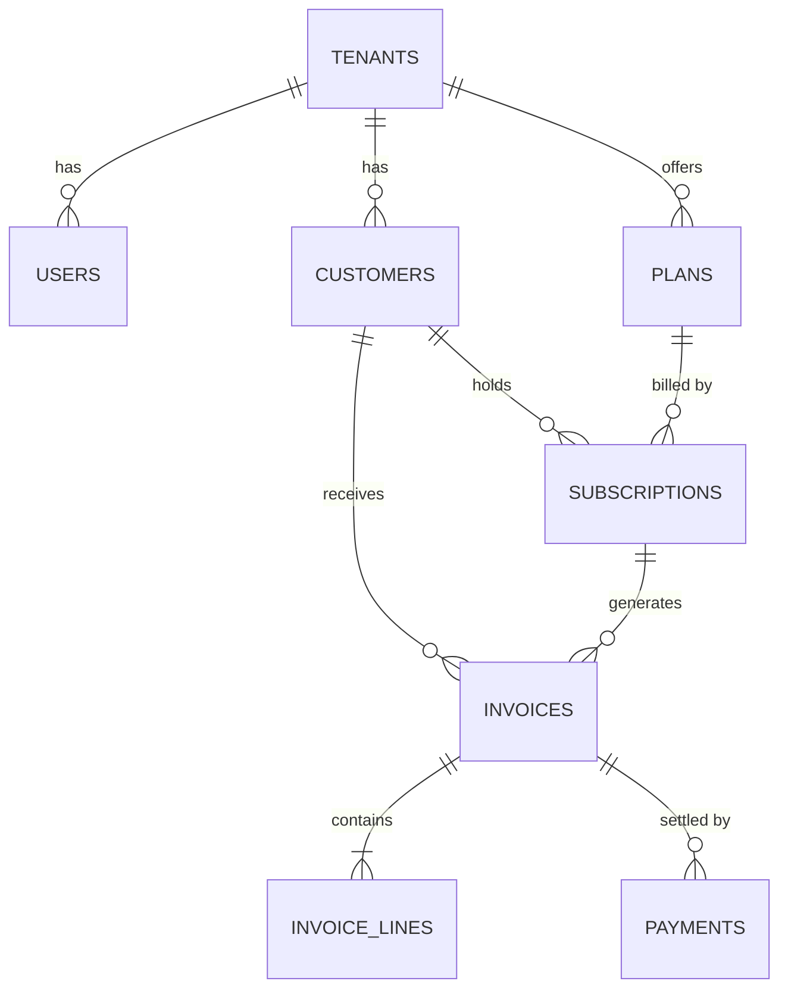

# Data model

Design notes:
- Every business table has `tenant_id`; all queries are tenant-scoped.
- Money is `NUMERIC(12,2)`, never floating point.
- Invoice numbers are unique per tenant.
- A partial index speeds up the recurring-billing job (active subscriptions that are due).
- A unique index on `(provider, provider_reference)` makes payment webhooks idempotent.
